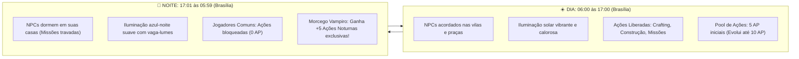

# ☀️🌙 Sistema de Ciclo Dia/Noite & Barra de Pontos de Ação (Horário de Brasília)

#engine #daynight #actions #gameloop #ui #vampire #brasilia

> **Objetivo:** Estabelecer o ritmo diário do jogo conectado ao relógio do mundo real (Horário de Brasília - UTC-3) e gerenciar a economia de energia do jogador através de uma barra de Pontos de Ação (Action Points - AP), com mecânicas exclusivas para a noite e bônus especial para o Morcego Vampiro.

---

## 1. ⏰ Definição do Horário de Brasília (UTC-3)

O ciclo de iluminação e comportamento dos NPCs da ilha é sincronizado em tempo real:



---

## 2. ⚡ Sistema da Barra de Pontos de Ação (Action Points - AP)

Para incentivar o progresso diário consistente e saudável para crianças sem permitir *grinding* excessivo:

### 2.1. Como Funcionam os Pontos de Ação
* **Início do Jogo:** O jogador recebe **5 Pontos de Ação (AP)** por dia.
* **Progressão Pedagógica:** Ao completar missões da trilha de lógica Lua e expandir a casa/tenda, a capacidade máxima aumenta gradativamente até **10 Pontos de Ação (AP)**.
* **Consumo de AP:**
  * Fabricar móveis / estruturas no Workbench: `-1 AP`
  * Cumprir uma etapa de missão com NPC: `-1 AP`
  * Chocar um ovo de dragão no ninho: `-1 AP`
* **Esgotamento (0 AP):** Quando a barra zera, o herói fica fadigado e impedido de realizar novos crafts até o reset das 06:00h da manhã. Apenas a exploração livre, passeio com dragões e pescaria contemplativa continuam liberadas.

---

## 3. 🦇 Mecânica Exclusiva: O Despertar do Morcego Vampiro

Durante a noite (após as 17:00h de Brasília), a vila dorme e as ferramentas normais são guardadas. No entanto:

* **Habilidade Passiva `Eco Noturno` dos Morcegos:**
  * Ao cair da noite (17:01h), o Morcego Vampiro (Masc/Fem) recebe **+5 Ações Noturnas Exclusivas** (`Night AP`).
  * Consegue realizar alquimia noturna, artesanato sombrio no Workbench e interagir com espíritos e criaturas da noite que aparecem apenas no escuro.
  * Durante a noite, o dragão companheiro do Morcego mantém o bônus de **+15% de velocidade de ataque**.

---

## 4. 🎨 Interface de Usuário (HUD Integrado ao Minimapa Circular)

Em vez de uma barra desconectada na tela, o indicador de **Ciclo Dia/Noite e Barra de Ações** é integrado diretamente na moldura externa circular do Minimapa:

```
             [ N ]   ☀️ (14:35)
          . - ~ ~ ~ - .
      . '   |   |   |   ' .      <-- Segmentos de Ação (AP)
    /   ■   |   ■   |   ■   \
   |  [W]    Radar do    [E] |
    \   ■   |   ■   |   □   /    <-- (□ = Ação gasta / ■ = Ação ativa)
      . '   |   |   |   ' .
          ' - _ _ _ - '
             [ S ]
```

* **Anel Orbital de Sol e Lua:** O ícone do **Sol ☀️** ou **Lua 🌙** percorre a borda externa do minimapa na posição angular do horário oficial de Brasília.
* **Segmentos de Ações Divididos por Linhas:** A moldura é fatiada em 5 a 10 blocos angulares discretos. Segmentos ativos brilham em **ouro/âmbar** (dia) ou **púrpura lunar** (morcego à noite); segmentos gastos apagam em cinza escuro.
* **Documentação Completa:** [[Circular & Expanded Tactical Minimap]].

## 🛠️ Implementação no Motor (`ActionPointManager.js`)

```javascript
export class ActionPointManager {
  constructor(player) {
    this.player = player;
    this.maxDayAP = 5; // Evolui até 10
    this.currentAP = 5;
    this.nightBonusGiven = false;
  }

  isDayTimeBrasilia() {
    // Obtém horário atual de Brasília (UTC-3)
    const now = new Date();
    const utcHours = now.getUTCHours();
    const brasiliaHours = (utcHours - 3 + 24) % 24;
    return brasiliaHours >= 6 && brasiliaHours <= 17;
  }

  updateTimeTick() {
    const isDay = this.isDayTimeBrasilia();

    if (isDay) {
      this.nightBonusGiven = false;
    } else {
      // Período Noturno
      if (this.player.species === 'bat' && !this.nightBonusGiven) {
        this.currentAP += 5; // +5 Ações Noturnas
        this.nightBonusGiven = true;
      }
    }
  }

  canPerformAction() {
    const isDay = this.isDayTimeBrasilia();
    if (!isDay && this.player.species !== 'bat') {
      return { allowed: false, reason: 'É noite! Os artesãos estão descansando até às 06h.' };
    }
    if (this.currentAP <= 0) {
      return { allowed: false, reason: 'Você esgotou seus Pontos de Ação de hoje!' };
    }
    return { allowed: true };
  }

  consumeAP(amount = 1) {
    const check = this.canPerformAction();
    if (!check.allowed) return false;
    this.currentAP = Math.max(0, this.currentAP - amount);
    return true;
  }
}
```

---

## 🔗 Links Relacionados
* [[00 - High Concept & Game Vision]]
* [[Catalog - Characters, NPCs & Generation Prompts]]
* [[Game Loop & Canvas Coordinator]]
