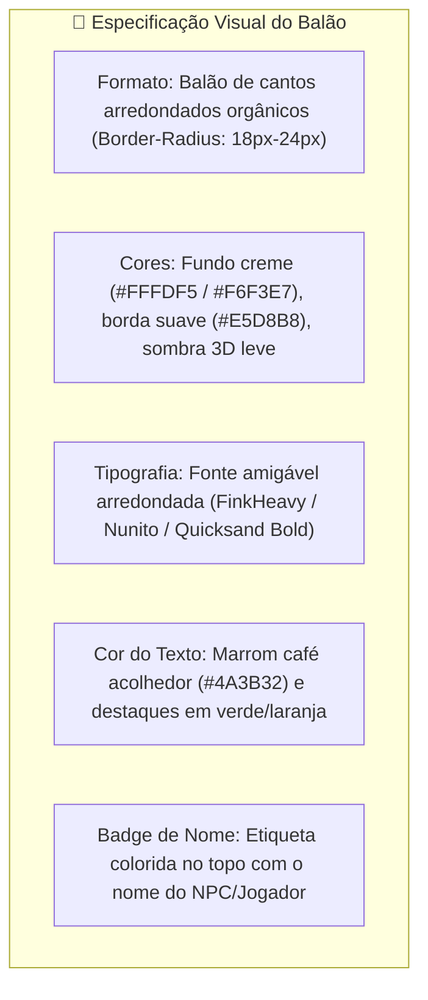
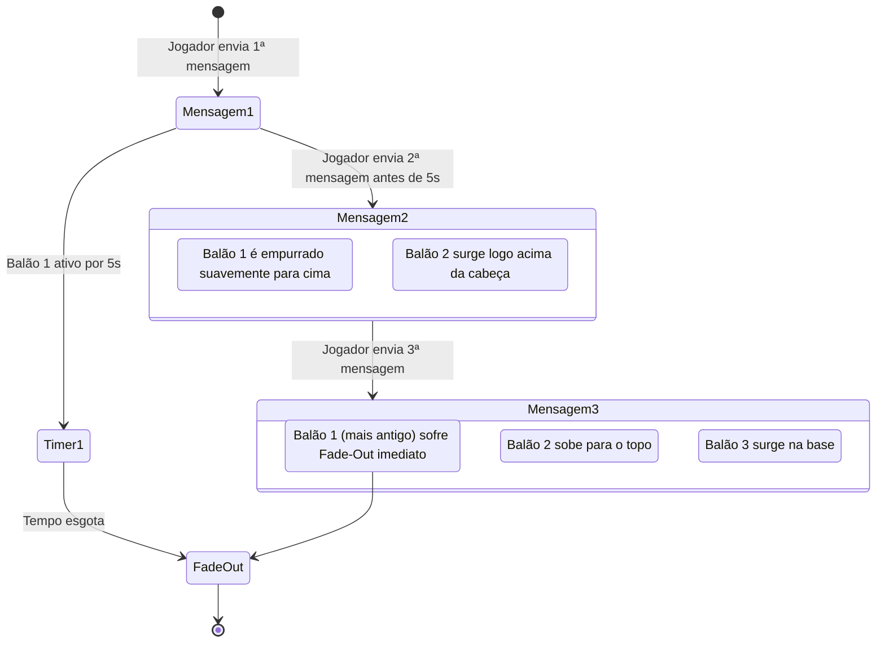

# 💬 Sistema de Diálogos & Balões de Fala Estilo Animal Crossing (NPCs & Chat)

#ui #dialogue #chat #animalcrossing #engine #multiplayer

> **Objetivo:** Recriar a experiência tátil, acolhedora e charmosa da interface de diálogos de *Animal Crossing: New Horizons*, tanto para conversas com NPCs quanto para o sistema de chat flutuante entre jogadores no MMORPG.

---

## 1. 🎨 Identidade Visual (Animal Crossing UI Guidelines)



---

## 2. 🗣️ Modos de Exibição de Fala

### 2.1. Diálogo de Missão com NPC (Modal Focado)
* **Posicionamento:** Parte inferior central da tela (HUD fixo) com avatar 2.5D animado do NPC à esquerda.
* **Efeito "Animalese":** Efeito de digitação letra por letra acompanhado por bipes suaves de sintetizador modulado conforme o tom de voz do animal (grave para o Touro Brutus, agudo para o Coelho Flora, rouco para a Coruja Arquimedes).
* **Botão de Avanço:** Ícone de triângulo piscante ou botão "A / Espaço" com animação de balanço sutil.

---

### 2.2. Chat Flutuante dos Jogadores (World-Space Speech Bubbles)

Quando um jogador digita uma mensagem no chat do MMO, um balão de fala dinâmico surge flutuando diretamente acima da cabeça do avatar no mundo do jogo.



---

## 3. 📐 Regras de Empilhamento e Prevenção de Poluição Visual (Max 2 Balões)

1. **Auto-Fade Timer:** Cada balão permanece visível por **5 segundos**. Após esse tempo, sofre transição suave de opacidade (*fade-out* de 0.4s) e é removido da memória do Canvas.
2. **Deslocamento Vertical (Shift Up):**
   * Posição do Balão 1 (Único): `y: avatar.y - 60px`
   * Posição do Balão 2 (Novo): `y: avatar.y - 60px`
   * Posição do Balão 1 (Empurrado): `y: avatar.y - 110px` (animação suave via LERP de 0.2s)
3. **Limite Rígido de 2 Balões:**
   * No máximo **2 balões simultâneos** por personagem.
   * Se o jogador digitar uma 3ª mensagem rápida, o balão superior é descartado imediatamente, mantendo o cenário limpo e legível para todos os jogadores na mesma área.

---

## 4. 🛠️ Estrutura de Código (Classe `SpeechBubbleManager`)

```javascript
export class SpeechBubbleManager {
  constructor() {
    this.bubbles = new Map(); // playerId -> Array de { text, createdAt, alpha, offsetY }
    this.MAX_BUBBLES = 2;
    this.BUBBLE_LIFETIME_MS = 5000;
  }

  addMessage(playerId, text) {
    if (!this.bubbles.has(playerId)) {
      this.bubbles.set(playerId, []);
    }
    const playerBubbles = this.bubbles.get(playerId);

    // Se já existirem 2 balões, descarta o mais antigo
    if (playerBubbles.length >= this.MAX_BUBBLES) {
      playerBubbles.shift();
    }

    // Empurra balões existentes para cima
    playerBubbles.forEach((b, idx) => {
      b.targetOffsetY = (playerBubbles.length - idx) * 45 + 60;
    });

    // Adiciona o novo balão na base
    playerBubbles.push({
      text: text,
      createdAt: Date.now(),
      alpha: 1.0,
      currentOffsetY: 60,
      targetOffsetY: 60
    });
  }

  update(deltaTime) {
    const now = Date.now();
    for (const [playerId, list] of this.bubbles.entries()) {
      for (let i = list.length - 1; i >= 0; i--) {
        const b = list[i];
        const age = now - b.createdAt;

        // Interpolação suave de subida (LERP)
        b.currentOffsetY += (b.targetOffsetY - b.currentOffsetY) * 0.2;

        // Fade-out no final da vida útil
        if (age > this.BUBBLE_LIFETIME_MS - 500) {
          b.alpha = Math.max(0, (this.BUBBLE_LIFETIME_MS - age) / 500);
        }

        if (age >= this.BUBBLE_LIFETIME_MS) {
          list.splice(i, 1);
        }
      }
    }
  }
}
```

---

## 🔗 Links Relacionados
* [[00 - High Concept & Game Vision]]
* [[Catalog - Characters, NPCs & Generation Prompts]]
* [[Multiplayer Synchronization (WebSockets)]]
* [[Game Loop & Canvas Coordinator]]
