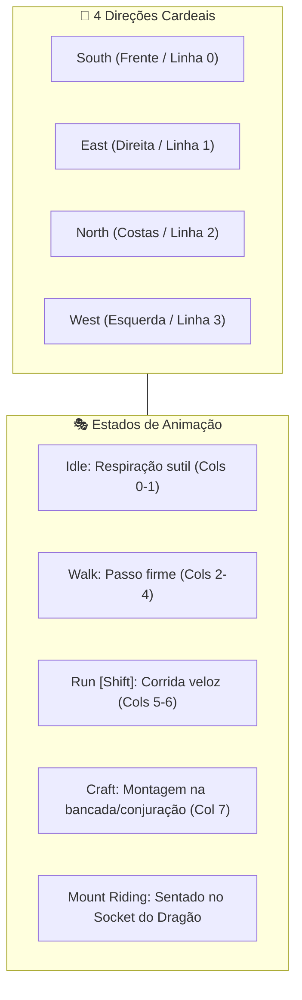

# ⚔️ Player Entity & 4-Way Movement

#engine #player #movement #animation #entity #4way

> **Arquivo Fonte**: [`src/engine/Player.js`](file:///Volumes/SSD%20FN501%20PRO/KidsLearnCode/src/engine/Player.js)  
> **Conceito:** O jogador se movimenta nas **4 direções cardeais** (Sul/Frente, Leste/Direita, Norte/Costas, Oeste/Esquerda), otimizando a fidelidade dos spritesheets e mantendo a jogabilidade limpa e precisa no grid.

---

## 🎯 Máquina de Estados e Movimento 4-Way

O herói se movimenta a uma velocidade base de **200 px/s** (ou **320 px/s** com sprint/Shift), alternando entre 4 linhas de animação:

---

## 🏃 Controles e Velocidades

| Ação | Teclas | Velocidade | Estado de Animação |
| :--- | :--- | :---: | :--- |
| **Parado** | Nenhuma tecla | 0 px/s | `idle` |
| **Caminhar** | `W`, `A`, `S`, `D` / Setas | 200 px/s | `walk` |
| **Correr (Sprint)** | `Shift` + `W, A, S, D` | 320 px/s (+60%) | `run` |
| **Fabricar** | Interação na Bancada (Workbench) | 0 px/s | `craft` |
| **Montar** | Tecla `B` próximo ao Dragão | Vel. do Dragão | `mount_riding` |

---

## 🔗 Links Relacionados
* [[Mount & Modular Character Layering System]]
* [[Catalog - Characters, NPCs & Generation Prompts]]
* [[Collision Detection & AABB Math]]
