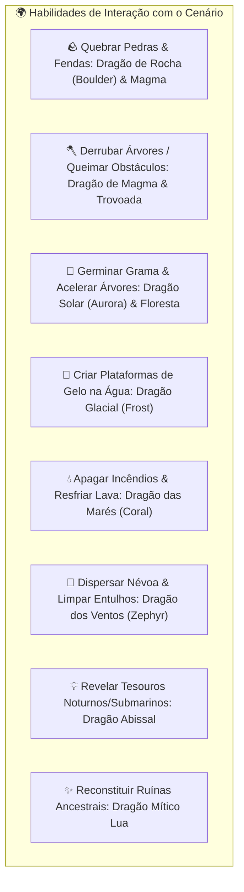
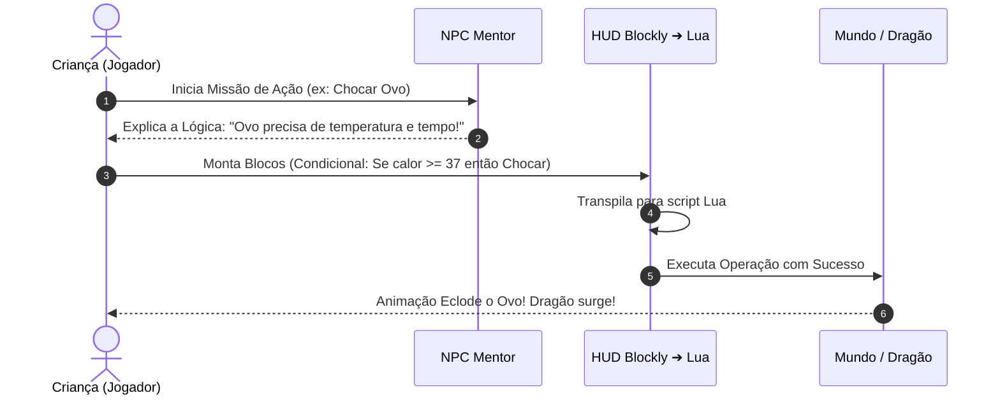

# 📜 Roteiro de Missões Lua & Interações de Cenário dos Dragões (Field Moves)

#edtech #lua #dragons #gameplay #fieldmoves #storyline #missions

> **Conceito Central:** Toda operação significativa no mundo — fabricar um item (*craft*), desenterrar um ovo, chocar no ninho, libertar um dragão na natureza, montar e usar habilidades no cenário (*field moves* estilo *Aniimo / Pokémon Pokopia*) — é ativada através da resolução de quebra-cabeças de programação em blocos visuais gerando código **Lua**.

---

## 1. 🐉 Catálogo de Interações de Cenário dos Dragões (Field Moves)

Assim como em *Pokémon Pokopia* e *Aniimo*, os dragões não servem apenas para locomoção e combate; eles são ferramentas vivas de transformação do mundo:



| Dragão | Elemento | Interação no Cenário (*Field Move*) | Efeito Visual e Físico | Código Lua Gerado no Bloco |
| :--- | :--- | :--- | :--- | :--- |
| `dragon_land_boulder` | Terra | **Quebra-Rochas (*Smash*)** | Destrói pedregulhos gigantes liberando passagens e minérios raros. | `dragon:smash_rock(target)` |
| `dragon_land_magma` | Fogo | **Chama de Corte (*Burn/Chop*)** | Queima troncos caídos e espinhos venenosos que bloqueiam caminhos. | `dragon:clear_obstacle("fire")` |
| `dragon_land_forest` | Natureza | **Germinação Rápida (*Bloom*)** | Faz brotar grama florida instantânea e acelera árvores em crescimento. | `dragon:bloom_area(x, y, 3)` |
| `dragon_fly_solar` | Luz | **Aurora Fértil (*Photosynthesis*)** | Emite calor celestial que faz florescer pomares inteiros de sementes. | `dragon:cast_sunlight(radius)` |
| `dragon_water_frost` | Gelo | **Caminho Glacial (*Freeze Water*)** | Congela azulejos de água em blocos de gelo transitáveis a pé pelo herói. | `dragon:freeze_surface(water_tile)` |
| `dragon_water_coral` | Água | **Jato Extintor (*Extinguish*)** | Apaga focos de fogo na vila e resfria piscinas de lava em pedra andesito. | `dragon:quench_fire(target)` |
| `dragon_fly_zephyr` | Vento | **Rajada Dispersora (*Gust*)** | Remove névoa densa de vales e sopra folhas cobrindo entradas secretas. | `dragon:clear_fog(area)` |
| `dragon_water_abyss` | Sombra | **Sonar Luminescente (*Glow Seek*)** | Ilumina abismos escuros e puxa baús e fósseis do fundo de lagoas. | `dragon:reveal_hidden_loot()` |
| `dragon_mythic_lua` | Mítico | **Restauração Cósmica (*Restore*)** | Reconstrói templos caídos e abre portais estelares com código Lua avançado. | `dragon:restore_ancient_ruin()` |

---

## 2. 📖 Roteiro Pedagógico: Operações do Jogo ➔ Desafios Lua em Blocos

Para cada mecânica introduzida, a criança aprende um novo pilar de pensamento computacional:



---

### 2.1. Missão 1: Primeira Ferramenta e Chamada de Funções
* **NPC Mentor:** *Brutus, o Touro Ferreiro*
* **Ação no Jogo:** Fabricar a primeira Pá de Ferro para cavar solo.
* **Conceito Lua:** Variáveis e Invocação de Função.
* **Desafio em Blocos:** Declarar o material e chamar `forjar("pá")`.
* **Código Lua Gerado:**
  ```lua
  local material = "ferro"
  local ferramenta = forjar("pa", material)
  player:equip(ferramenta)
  ```

---

### 2.2. Missão 2: Desenterrando e Obtendo o Primeiro Ovo
* **NPC Mentor:** *Lyra / Ragnar (Lobo Caçador)*
* **Ação no Jogo:** Usar a Pá no ponto com pegadas brilhantes para desenterrar um ovo.
* **Conceito Lua:** Condicionais (`if / then / else`) e Verificação de Solo.
* **Código Lua Gerado:**
  ```lua
  if player:get_ground_type() == "buraco_escavado" then
      local item = player:dig()
      if item == "ovo_de_dragao" then
          player:add_inventory(item)
      end
  end
  ```

---

### 2.3. Missão 3: Chocando o Ovo no Ninho Incubador
* **NPC Mentor:** *Flora, a Coelho Fazendeira*
* **Ação no Jogo:** Aquecer o ninho e definir se o dragão será Treinado ou Libertado.
* **Conceito Lua:** Operadores de Comparação e Escolha Lógica.
* **Código Lua Gerado:**
  ```lua
  local temperatura = ninho:get_temperatura()
  local tempo_minutos = 5

  if temperatura >= 38 and tempo_minutos >= 5 then
      local bebe_dragao = ninho:hatch("dragon_land_boulder")
      player:choose_action(bebe_dragao, "treinar") -- ou "liberar"
  end
  ```

---

### 2.4. Missão 4: Fabricando a Ponte de Madeira (Workbench)
* **NPC Mentor:** *Bambu, o Macaco Construtor*
* **Ação no Jogo:** Criar uma ponte modular sobre o rio para atravessar sem barco.
* **Conceito Lua:** Laços de Repetição (`for`).
* **Código Lua Gerado:**
  ```lua
  local largura_rio = 4
  for i = 1, largura_rio do
      workbench:craft_tile("struct_bridge_wood_horiz", i)
  end
  ```

---

### 2.5. Missão 5: Ativando o Primeiro *Field Move* (Criar Gelo na Água)
* **NPC Mentor:** *Kai, o Tubarão Surfista & Pingo, o Pinguim*
* **Ação no Jogo:** Comandar o Dragão Glacial para criar um caminho congelado sobre as ondas.
* **Conceito Lua:** Manipulação de Eventos e Parâmetros de Objeto.
* **Código Lua Gerado:**
  ```lua
  function atravessar_lago(dragao, tiles_agua)
      for _, tile in ipairs(tiles_agua) do
          dragao:freeze_surface(tile)
      end
  end
  atravessar_lago(meu_dragao, rio:get_caminho())
  ```

---

### 2.6. Missão 6: Libertando Dragões e Karma Ecológico
* **NPC Mentor:** *Mestre Casco, a Tartaruga Anciã*
* **Ação no Jogo:** Devolver um dragão adulto à natureza para reflorestar uma área degradada da ilha.
* **Conceito Lua:** Funções com Retorno e Recompensas Dinâmicas.
* **Código Lua Gerado:**
  ```lua
  function devolver_a_natureza(dragao)
      local recompensa = dragao:release_to_wild()
      player:add_karma(50)
      island:grow_rare_trees(recompensa.area)
  end
  devolver_a_natureza(meu_dragao)
  ```

---

## 🔗 Links Relacionados
* [[Catalog - Dragons, Species & Generation Prompts]]
* [[Catalog - Characters, NPCs & Generation Prompts]]
* [[Catalog - Craftable Items, Tiles & Generation Prompts]]
* [[00 - High Concept & Game Vision]]
* [[Mount & Modular Character Layering System]]
